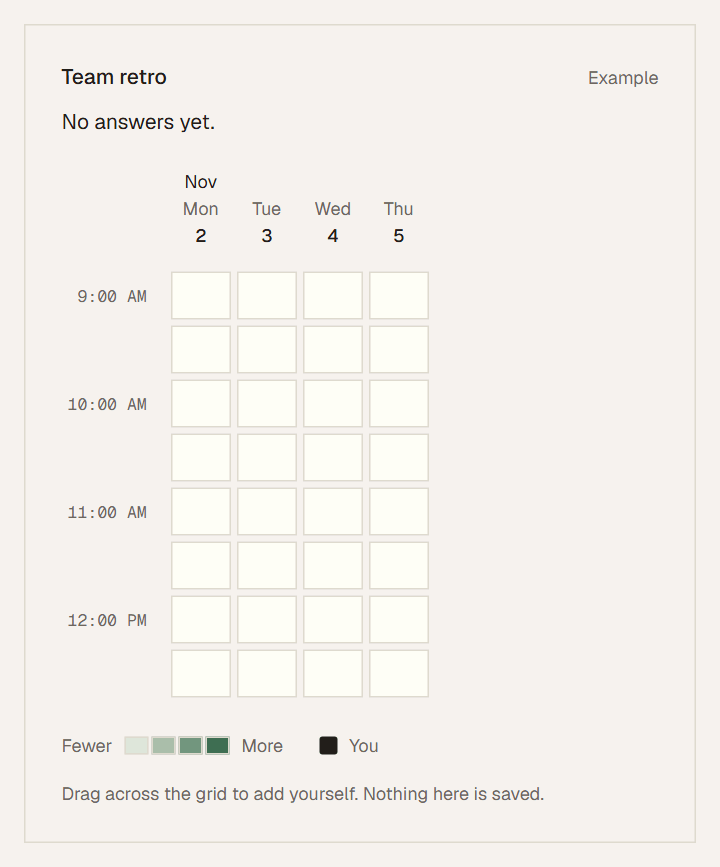
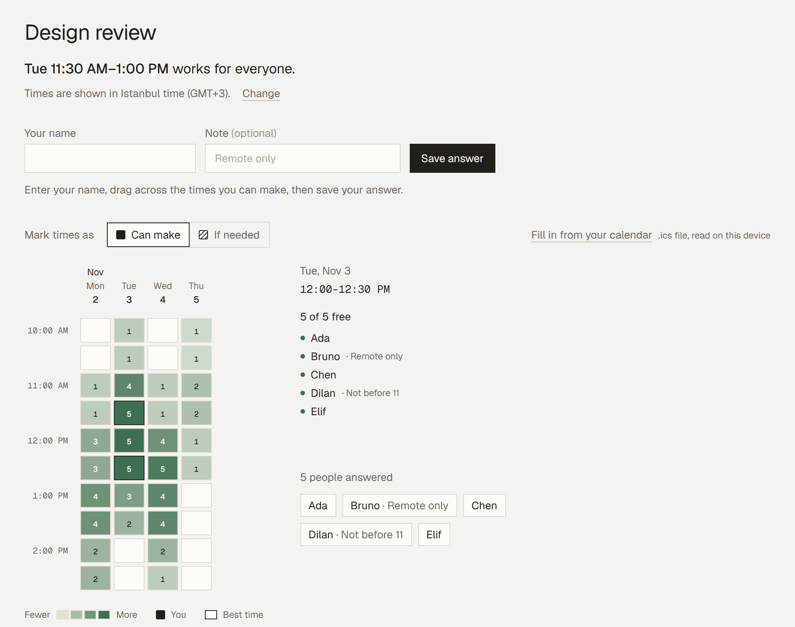
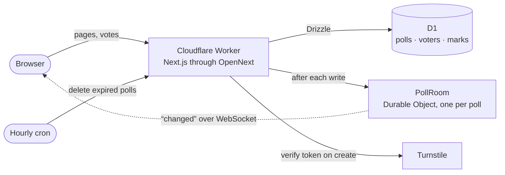

# overlap

Pick a few days, send one link, and see which time works for everyone.

<picture>
  <source media="(prefers-color-scheme: dark)" srcset="docs/screenshots/demo-dark.gif">
  
</picture>

Overlap is a small scheduling poll. You choose some days and a window of hours, share the link, and everyone drags across the times they can make. The page then tells you the answer in one sentence, like *"Tue 11:30 AM–1:00 PM works for everyone"*, shown in each person's own timezone.

There are no accounts. Creating a poll gives you two links: a public one to share, and a secret one that's the only way to edit or delete the poll. You can email both to yourself; the address is used once and never stored.

## What it does

<picture>
  <source media="(prefers-color-scheme: dark)" srcset="docs/screenshots/poll-dark.png">
  
</picture>

- **Timezones done properly.** Everyone sees the grid in their own zone, with their own 12- or 24-hour clock and first day of the week. If you're planning from another city, you can switch the zone next to the times.
- **"If needed" answers.** Mark a time as one you can make, or one you'd rather not but could. The best time is the one most people can make, and among those, the one the fewest only "could".
- **Fill in from your calendar.** Pick an `.ics` export from Google Calendar, Outlook or Apple Calendar and every time it leaves free gets marked. The file is read in the browser and never uploaded.
- **Notes.** A short line next to your name, like "Remote only".
- **Export.** The owner can download every answer as a CSV, with times in their own timezone.
- **Weekly polls.** Ask about days of the week instead of dates when something repeats. The answer then reads "Mondays 6:00–7:00 PM".
- **A final time.** The owner picks one of the best times, or drags any stretch on the grid. Everyone can add it to their calendar, and re-importing after a change updates the event instead of duplicating it.
- **Live.** New answers and the owner's changes show up on every open page without a reload.
- **Deadlines.** The owner can close voting, set a deadline, or reopen it. An open page goes read-only the moment voting closes.
- **Link previews.** Pasting a poll link in a chat shows the title, how many people answered and a small heatmap. Poll pages are never indexed.

Polls delete themselves 30 days after their last time, or three months after a weekly poll was made.

## How it works



The whole app runs on a single Cloudflare Worker. A few decisions I'd point out:

- **The secret link is never stored.** The database keeps a SHA-256 hash of it, so a copy of the data can't be used to edit or delete anything. Voters are identified by a cookie, and the owner page refers to answers by a hash of that cookie, never the cookie itself.
- **Live updates carry no data.** After a write, the poll's Durable Object tells open pages "changed", and each page re-renders on the server for its own viewer. Sockets use the hibernation API, so an idle poll costs nothing. If a socket drops, the page checks every 20 seconds until it reconnects.
- **Typed queries with Drizzle.** The schema lives in `src/db/schema.ts`. A poll loads with its voters and their marks in one query, and a vote is saved as one D1 batch, so it's all or nothing. Marks go in through `json_each`, because D1 allows only 100 bound values per statement and a poll can have hundreds of slots.
- **Weekly polls reuse everything.** Their times are stored as one real reference week, so the grid, the ranking and timezone conversion work exactly as for dates. Only the labels change.
- **Abuse protection without accounts.** Creating a poll and answering one for the first time are checked with Turnstile, which stays invisible unless it needs a click and only loads once its form is on screen. Later edits are tied to the voter's cookie, so they skip the check. Writes are rate limited per network with Cloudflare's rate limiter, keyed by a hash of the address.
- **Locked down by default.** Every response has a Content Security Policy, HSTS and anti-framing headers.

Built with Next.js 16, React 19, Tailwind CSS 4, TypeScript 7, Drizzle ORM, Cloudflare Workers, D1, Durable Objects and Turnstile. Bun runs the installs and the tests.

## Project layout

```
src/
  app/          routes, API handlers and preview images
  components/
    home/       the landing page and the create form
    poll/       the poll page and the owner page
    common/     the site shell and pieces both use
  server/       runs only on the Worker: queries, rate limits, Turnstile, the live room
  client/       runs only in the browser: hooks, local storage, requests
  lib/          plain logic shared by both, covered by the unit tests
  db/           Drizzle schema
migrations/     SQL migrations, applied by Wrangler
tests/          unit tests (bun test)
e2e/            browser tests (Playwright)
worker.ts       the Worker entry: app, WebSockets and the hourly purge
```

## Running it locally

You'll need [Bun](https://bun.sh).

```sh
bun install
cp .dev.vars.example .dev.vars
bun run db:migrate
bun run dev
```

Then open http://localhost:3000. The database is a local D1 that Wrangler keeps on your machine. `.dev.vars` holds Cloudflare's public Turnstile test key, which the server only accepts in development.

`next dev` can't run Durable Objects, so in dev mode open pages poll for changes every 20 seconds instead. To get the real thing, run `bun run preview`, which builds the Worker and runs it in workerd, the same runtime as production.

| Command | What it does |
| --- | --- |
| `bun run check` | Typecheck, lint and unit tests |
| `bun run test` | Unit tests only |
| `bun run test:e2e` | Browser tests with Playwright, against `bun run dev` |
| `bun run db:generate` | Write a migration after changing `src/db/schema.ts` |
| `bun run db:migrate` | Apply migrations to the local database |
| `bun run preview` | Build the Worker and run it locally |

GitHub Actions runs the checks, both builds and the browser tests on every push.

## Deploying

1. Create a D1 database called `overlap` and put its id in `wrangler.jsonc`.
2. Apply the migrations: `bunx wrangler d1 migrations apply overlap --remote`.
3. Store the Turnstile secret: `bunx wrangler secret put TURNSTILE_SECRET`.
4. Check that `TURNSTILE_HOSTNAMES` in `wrangler.jsonc` lists your domain.
5. To send the link emails, set up Cloudflare Email Sending for the domain, so the `EMAIL` binding can send from `links@overlap.cendik.dev`. Without it the email form stays hidden.
6. `bun run deploy`.

For visit counts, set `NEXT_PUBLIC_CF_WEB_ANALYTICS_TOKEN` to a Cloudflare Web Analytics token when building. It's cookieless, and it only runs on the home page and public poll pages, never on secret links.

Production builds use https://overlap.cendik.dev for absolute preview URLs. Set `SITE_URL` while building to use another address.

## Limits

| | |
| --- | --- |
| Days per poll | 14, or one week for weekly polls |
| Hours per day | up to 12, in 30-minute slots |
| People per poll | 40 |
| Title / name / note | 80 / 40 / 80 characters |
| New polls | 5 a minute per network |
| Link emails | 3 a minute per network |
| Saved answers | 60 a minute per network |

The days and hours can change while nobody has answered yet. People can remove their own answer until voting ends, and the owner can remove any answer at any time.

## How I built this

Overlap was built with help from Claude Code, an AI coding agent. These are my contributions:

- The idea and its limits: no accounts, one public link and one secret link, nothing to install.
- The visual direction: a warm paper background, ink-coloured text, hairline borders and a single green accent.
- The stack choices: Bun, Drizzle instead of hand-written SQL, Turnstile and Cloudflare's rate limiter.
- Which features to build and in what order, and the name and domain.

The parts I found most interesting were the ones where a constraint shaped the design: D1's limit on bound values deciding how answers are inserted, Durable Objects that only ever say "changed", and weekly polls stored as a real week so nothing else had to change.

## License

MIT
